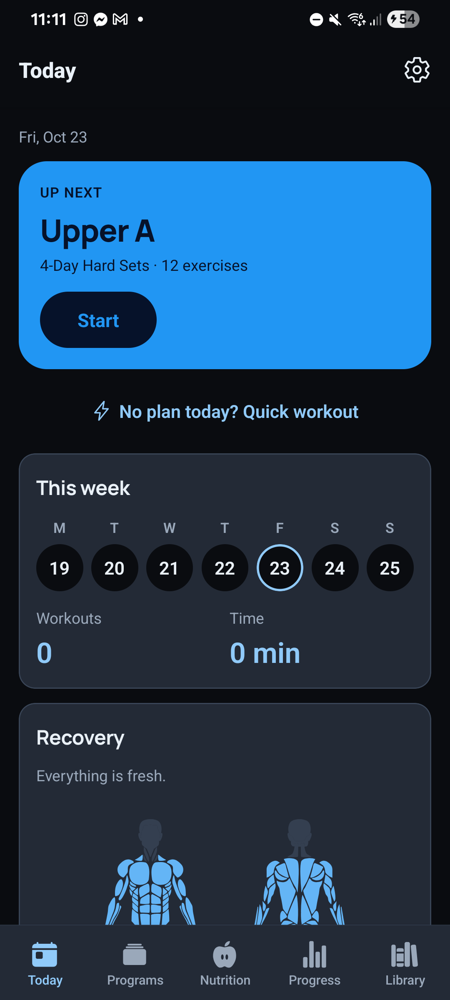
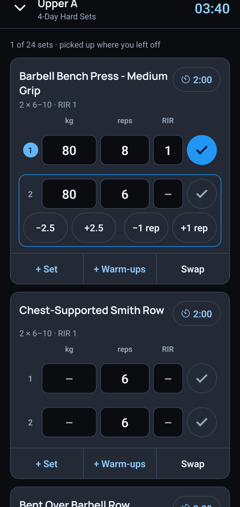
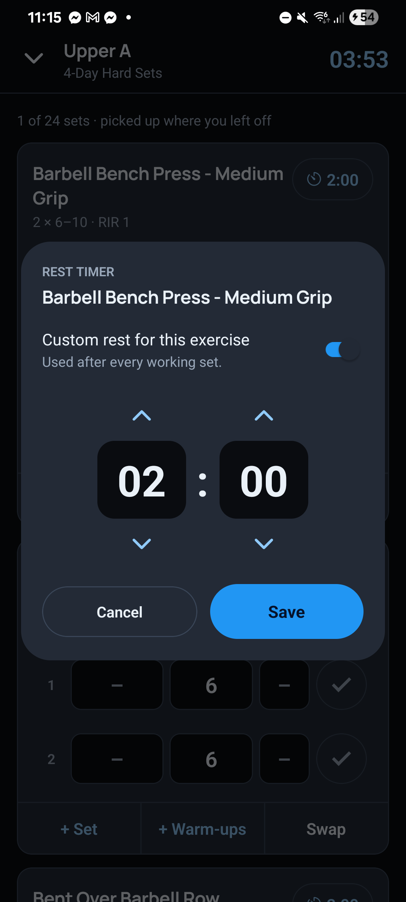
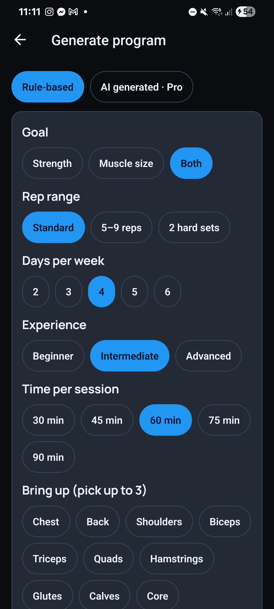
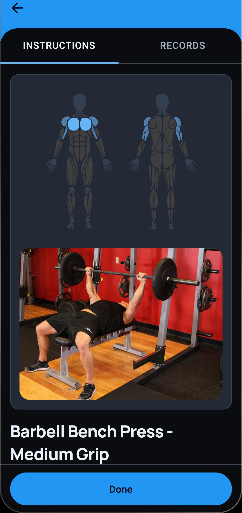

# Spotty

A free, open-source workout app for Android (iPhone is planned), built around a quiet training partner: it logs your sets,
times your rest, suggests when to add weight, and speaks up only when it helps.

No account. No subscription. No ads. Everything you log stays on your phone (SQLite).

<p align="center">
  
  
  
  
  
</p>

## What it does

- **Today** shows your next workout with one Start button, your week, and which muscles have recovered (front and back body map).
- **Programs** are a shelf of workouts. Start one and a full-screen session opens with a running clock and rest timers.
- **Rest timers per exercise.** Set how long each exercise rests, per workout, or fall back to your defaults.
- **Progression built in.** Weights are suggested from your last session and go up once you hit the top of the rep range on every set.
- **Effort at a glance.** Enter reps in reserve (RIR) and the set number is tinted from easy to all-out.
- **Rule-based program generator.** Pick your goal, days, experience, time and equipment. Styles: standard, 5–9 reps, or 2 hard sets on an upper/lower split.
- **Library of 876 exercises** with muscle maps and start/end photos from [free-exercise-db](https://github.com/yuhonas/free-exercise-db) (public domain).
- **Personal records, history, body weight trend, weekly muscle volume.**
- Light and dark themes that follow your phone.

Nutrition tracking is coming soon.

## Support the project

Spotty is free and always will be. If you want to support development, you can [sponsor on GitHub](https://github.com/sponsors/Jijots) or leave a one-off tip on [Ko-fi](https://ko-fi.com/jijots).
Supporters help fund the Pro ideas on the roadmap: AI-generated programs and importing workouts from videos or links.

## Run it

Requires Node 20+ and the Expo Go app (or an Android build).

```bash
npm install --legacy-peer-deps
npx expo start --go
```

Scan the QR code with Expo Go. Run the tests with `npm test` and the type check with `npx tsc --noEmit`.

### Build an Android APK locally

```bash
npx expo prebuild --platform android
cd android && ./gradlew assembleRelease
```

You need the Android SDK and a JDK 17 or 21. For store builds, create your own signing key and keep it safe.

## Credits

- Exercise data and photos: [free-exercise-db](https://github.com/yuhonas/free-exercise-db) (public domain).
- Body map: [react-native-body-highlighter](https://github.com/HichamELBSI/react-native-body-highlighter) (MIT).
- Headings: [Manrope](https://github.com/sharanda/manrope) (SIL Open Font License).
- Built with [Expo](https://expo.dev) and React Native.

## License

[MIT](LICENSE). Spotty is not medical advice. Talk to a professional before starting a new training program.
